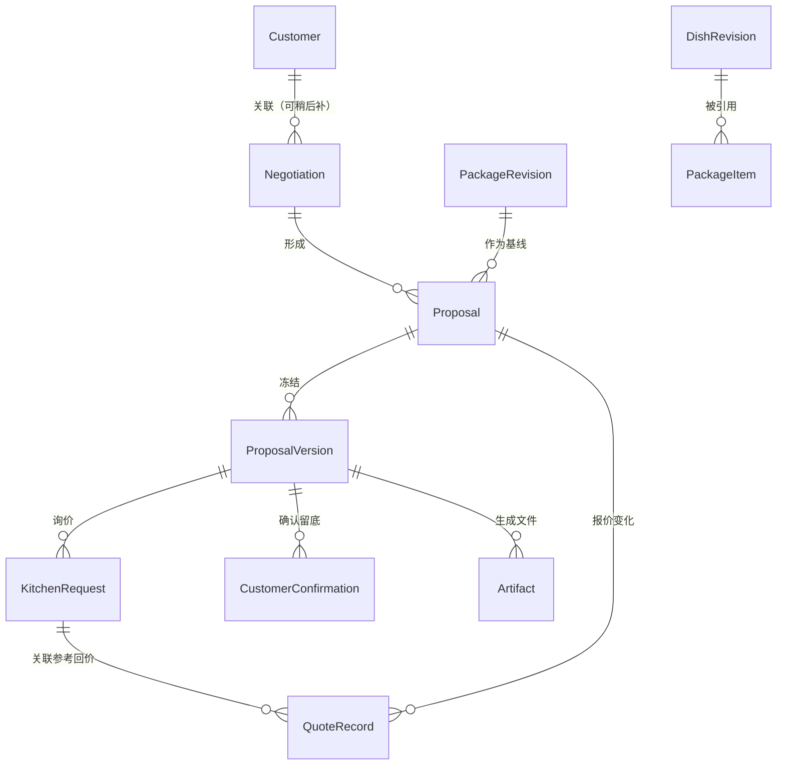

# 架构

> 最终确认版，2026-09-06 生效。目标是 Android APK 本地优先；现有 PWA 仅为迁移前基线与回退。下列历史审计不构成保留旧技术的约束。当前只实施阶段 1，尚不表示技术验证已通过。

### 1. 历史证据： 代码审计与证据

当前自有核心代码约：app.js 2527 行、custom.js 1740 行、style.css 1896 行；后叠加 order-layout.js/css、immersive.js。超大文件本身不是业务错误，但当前业务状态、DOM、动画、导出和存储相互依赖，增加了回归成本。

| 编号 | 发现 | 证据及影响 | 判断性质 |
| --- | --- | --- | --- |
| A01 | 定制不持久化 | custom.js:73 的 draft、enter:78；app.js:setMode 每次进入调用 enter。没有方案存储 | 静态确认 |
| A02 | 原始版菜品与价格可不匹配 | getExportLines 选 originalLines，buildSVG/buildMobileSVG 仍读 draft.total；原始菜可带修改后的价格 | 静态确认，需要行为回归 |
| A03 | 客户与厨房数据未隔离 | renderDishName 及小票无图 mark 对换菜/新增输出痕迹；note 无受众字段。不同用途共享全量 draft | 静态确认 |
| A04 | 厨房链路重复且有信息遗漏风险 | buildChefSVG 独立遍历 draft.lines，没有输出 removedLines；另一 mobile chef 分支输出删除列表 | 静态确认 |
| A05 | 连续换菜丢原基线 | swap handler 把 swappedFrom 设为上一次菜品；A→B→C 后只记 B→C | 静态确认 |
| A06 | 单页缩放不是内容分页 | buildSVG/buildPackageSVG 根据菜数压缩行高；wrapCn 超限截断；整宴席每套餐一页 | 静态确认 |
| A07 | 导出可以静默缺页 | exportWholeMenu 的 rasterize 失败及异常后 next()，只要有页就生成 PDF | 静态确认 |
| A08 | 导出依赖可变状态 | 回调中临时替换 draft.lines；图片/字体未形成完整资源屏障；_thumb 挂到对象上且缺少版本缓存键 | 静态确认，异步竞态待复现 |
| A09 | 保存非事务、备份不是历史 | Store.save 在写盘前改 revision；CRUD 先改 STATE。备份只含 library/menu，且保存后覆盖，缺分类、门店、Logo 等完整恢复内容 | 静态确认 |
| A10 | 坏数据可能被种子遮盖 | load 解析失败忽略错误后 seed；normalizeState 无条件设 schemaVersion=3，未来版本未拒绝 | 静态确认 |
| A11 | 删除撤销不能还原引用位置 | getUsages 不存位置，restoreRefs 用 push；同名内嵌迁移仅按 cn 去重，可能误合并 | 静态确认 |
| A12 | 并发检查存在竞态 | publishToWebDAV 先 GET 再 PUT，GET 错误被吞掉，无 If-Match；worker 不转发条件写头 | 静态确认 |
| A13 | 凭据模型和注释不一致 | webdav.js 持久化 username/password/token，实际 password 可作 token；worker 服务端持 WebDAV 账号，但单共享 token 不隔离销售 | 静态确认，不检查真实凭据 |
| A14 | 离线包不完整且发布可混版 | sw.js ASSETS 与构建 HASH_FILES 缺 webdav.js、immersive.js；网络优先逐文件刷新、立即 skipWaiting/claim，不能保证一次会话一致版本 | 静态确认；设备影响待测 |
| A15 | 缓存匹配与声明不一致 | fetch handler 不排除查询参数；启动请求 menu-config.json?t=时间戳，与静态预缓存键不同 | 静态确认，首次离线路径需实测 |
| A16 | 存在入口与导航债务 | order-layout.js 读 DOM 和重放 click；previewPrev/previewNext 取到元素但未发现绑定；csDone/mgDone 仅在沉浸初始化绑定 | 静态发现，需真实页面验证 |
| A17 | 文档不等于实现 | UI 文档规定主题/触控/无障碍，但实现固定 shanshui、viewport 禁缩放、存在大量局部颜色和高 z-index；旧 guest-mode CSS 仍在 | 静态确认 |
| A18 | 有远程依赖及上报 | index.html 加载 Google 字体与 Beacon；上报 location.href/referrer。不能直接复制到含客户数据的新工作台 | 静态确认，未连接上报服务 |
| A19 | 发布工具可能先写图后判断冲突 | publish-menu.js 先 externalizeImages，再做 revision 判断；图片以菜品 ID 命名覆盖旧文件 | 静态确认 |
| A20 | 自动拉取错误可能被测试漏掉 | pullFromCloud 在 bindStatic 之外引用其局部 BrandConfig；异常被 catch 吞掉后仍可能已导入数据；现有测试不检查拉取函数的真实完成状态 | 静态作用域确认；本轮不修复 |

### 2. 历史基线： 基线验证与覆盖边界

2026-09-06 在 src 执行 npm test：失败于首项 build-sw-cache.js --check。当前键 ss-menu-e03ea90ec594，按工作目录文件计算应为 ss-menu-91933376d61e。为了保留审计基线，没有执行会改写 sw.js 的构建。

为避免首项失败遮蔽后续结果，分别运行其余九个脚本，均退出 0：data-images.test.js、strategic-model.test.js、copy-pkg.test.js、custom-order.test.js、logo-config.test.js、menu-export.test.js、guest.test.js、settings-webdav-smoke.js、theme-smoke.js。总套件仍是失败，不能写“全部测试通过”。

这些测试主要是 jsdom/VM 和源码正则；部分手动注入 qrcode.js，未按正式入口加载全部运行脚本；部分容忍 Canvas 未实现。guest.test.js 未读取 style.css，因此无法发现残留 guest-mode 样式。战略测试仅检查 revision 字符串存在，不能证明并发安全。PDF 头尾/对象检查不能证明中文排版、缺页或视觉正确。

辅助脚本中，a4-test.js 另有布局实现，check-bounds.js 未测文字真实边界；render/verify 脚本仍引用 prototype 输出或开发机绝对依赖路径，@resvg/resvg-js 未在 package.json 声明。cf-check.js 含可选远端写操作，本轮未运行；发布、Worker 部署、真实同步均未运行。

本轮不宣称完成 Android、真实浏览器触控、图片逐张质量、真实设备本地库或视觉导出验收。现有依赖足够运行上述九项，无需安装或升级。Git 所有权检查和 LFS 临时文件写权限受环境限制；使用命令级只读配置读取状态，未改全局 Git 设置。关闭 LFS 过滤的状态显示 menu-config.json 为 M，可能是实体与 LFS 指针差异，不能据此认定为用户改动或本轮改动；本轮不改该文件。

### 3. APK 技术路线比较与建议

比较是针对 Android 平板、2–3 名销售和现有 Web 资产的工程判断，不是已经测得的性能结论。

| 路线 | 离线/数据 | 触控、返回、文件 | 导出与图片 | 维护成本 | 结论 |
| --- | --- | --- | --- | --- | --- |
| 原生 JS PWA 继续拆模块 | 浏览器数据库可改善，但浏览器生命周期/清理仍需处理 | 浏览器边界，不能提供完整 APK 系统能力 | 现有 SVG 可复用，需解决字体与 Canvas | 起步低，导航债务持续 | 保留旧版回退，不作 APK 最终路线 |
| 直接 WebView 加载旧 PWA | 内存草稿/localStorage 问题原样保留 | 只是变成 APK，返回/文件还需写桥接 | 导出问题不会因套壳消失 | 表面低，隐性高 | 拒绝作为产品重构 |
| 现代 Web SPA + Capacitor + 原生持久化适配 | 原生 SQLite/文件；本地事务先行 | 专门接生命周期、返回、文件保存；仍需 Android 测试 | 复用 SVG 几何经验，独立输出流水线 | 中；TS 和少量 Kotlin 两种语言 | 首选验证路线 |
| Kotlin + Compose + Room | Android 原生存储、生命周期整合直接 | 返回、文件、隐私遮罩实现路径直接 | UI 与导出仍应分离，旧 SVG/JS 复用较少 | 当前仓库迁移投入高，长期 Android 单平台可控 | Hybrid 验证失败后的备选 |
| Flutter / React Native | 可做本地数据库，仍要桥接/依赖评估 | 可提供移动体验 | 现有 DOM/SVG 布局不能直接照搬 | 新工具链与旧资产迁移同时发生 | 当前没有足够收益优先选 |

建议新 UI 用 TypeScript + React + Vite 的本地 SPA；不需要 SSR、在线路由服务或云端业务后端。选 React 是为组件、类型化状态和可测试边界，不是因为现有页面值得原样搬运。Capacitor 负责原生容器和桥接，APK 随包携带代码、字体、占位图和正式初始菜单，不运行远程页面、不依赖 Service Worker 才能启动。

正式数据库建议通过窄接口 Kotlin 插件接 Room/SQLite，UI 只调用领域命令和查询，不开放任意 SQL。也可在验证阶段评估社区 SQLite 插件；不能把社区插件误写成 Capacitor 官方自带数据库。两者只选一个，不长期维护两份 Android 存储实现。旧 PWA 留作过渡回退，MVP 不承诺同步维护功能完全相同的 Web 与 Android 两端。

第一道技术门禁是小规模原生验证：事务保存后杀进程恢复、受限展示返回/重启、离线中文 PNG/PDF、导出文件重新打开、100 道菜分页与低内存压力。任何一项核心约束不达标，先比较修复代价，再转向全 Kotlin；不在做完所有页面之后才发现容器路线不合适。

官方依据（2026-09-06 查阅）：[Capacitor 原生能力](https://capacitorjs.com/docs)、[App 生命周期与返回事件](https://capacitorjs.com/docs/apis/app)、[存储指南](https://capacitorjs.com/docs/guides/storage)、[文件 API](https://capacitorjs.com/docs/apis/filesystem)。本地源作为读取真源、写入后再同步的方向符合 [Android offline-first 指南](https://developer.android.com/topic/architecture/data-layer/offline-first)。具体版本、最低 Android 版本、插件许可与兼容组合在验证阶段锁定，不凭当前信息给出未验证的支持承诺。

### 4. 模块边界与数据流

```text
src/                         （后续目标，当前未创建）
├─ app/                      路由、身份、受限展示、恢复协调
├─ features/                 today / catalog / negotiation / proposal / operations
├─ domain/                   实体、不变量、命令、报价适用性、差异计算
├─ data/                     repository、迁移、校验；现有资产迁移期保留
├─ export/                   audience projections / layout / templates / output
├─ media/                    资源、裁剪、字体、内容哈希
├─ platform/                 存储、文件、生命周期、备份、同步适配
├─ ui/                       tokens / components
├─ android/                  原生项目及窄接口插件
├─ tests/                    domain / migration / integration / export / device
└─ tools/                    可复现构建及验证
```

UI 事件→命令校验→数据库事务（工作稿、业务事件、必要 outbox 同事务）→查询刷新 UI。界面可即时反馈，但只有事务成功才显示已保存；失败保留当前输入，允许重试与复制恢复。不等待应用切后台才保存，不用 DOM 作为状态源。

离散动作立即排队提交；输入草稿可每次输入顺序落库，后台再合并，性能优化不可让未持久化内容显示为已保存。结构化金额只在完整合法时生效，中间输入保留在编辑草稿。重启只恢复已提交状态，不能承诺操作系统终止前未提交的字节一定保留。

### 5. Core Data Model

所有内部 ID 为稳定 UUID，展示编号可改；金额为整数分、currency=CNY、basis=perTable，null 表示未报价，0 不代表未知。日期型宴会日独立存 YYYY-MM-DD；事件时刻存 UTC，显示当地时间；时间戳不作为跨设备唯一排序或冲突胜负依据。

| 实体 | 核心字段 | 关系/约束 |
| --- | --- | --- |
| Hotel | id、name、brandRevisionId | 单酒店 MVP，不扩展 SaaS 多租户管理 |
| StaffProfile | id、hotelId、displayName、role、status | sales/operations；显示名不是身份 ID；停用不删除历史署名 |
| Device | id、assignedStaffId、lastBackupAt | 一个主写设备/销售为默认运行约定 |
| Category / BanquetType | id、name、sortOrder、status | 分类用稳定 ID，改名不丢菜；旧字符串另留迁移映射 |
| MediaAsset | id=contentHash、mime、width、height、localPath、bytes | 文件不可原地覆盖；Logo、原图/派生图分引用，记录来源及派生参数 |
| Dish / DishRevision | id、currentRevisionId；cn、en、categoryId、description、imageAssetId、crop、status | 菜品主身份单一；修订只增不改；被历史版本用的修订不可清理 |
| Package / PackageRevision | id、banquetId、code、name、priceMinor、status、recommended、items、revisionId | 公共标准价；发布冻结修订 |
| PackageItem | id、dishId、dishRevisionId、position、nameOverride | 稳定行 ID，排序是 position；覆盖含 cn/en，可明确区分缺省和清空 |
| UpgradeComparison | fromPackageRevisionId、toPackageRevisionId、pairedItems、approvedSummary | 不按行号强行推断升级；新增/移除可自动算，替换配对由运营审核 |
| Customer | id、ownerStaffId、称呼、电话、备注 | 字段可空；电话非唯一键，不自动合并同家庭联系人 |
| Negotiation | id、customerId?、ownerStaffId、startedAt、status、banquetTypeId、eventDate?、tableCount?、budget?、followUpDate? | 一客户可多次到店/多场宴会；日期桌数属于本次需求，不写死在客户上 |
| Proposal | id、negotiationId、ownerStaffId、sourcePackageRevisionId、currentDraftId、latestVersionId | 一洽谈可多个备选方案，界面默认一个；MVP 不做多人共同编辑 |
| ProposalDraft / DraftLine | id、parentVersionId、contentRevision、lines、notes；lineId、baseItemId?、source、position | source 是库修订引用或方案内临时菜；保留原套餐行关联 |
| TemporaryDish | id、proposalId、name、categoryId、governanceStatus | 只在方案域；运营升库后只影响后续选择，不改既有快照 |
| ProposalVersion | id、proposalId、ordinal、parentVersionId、kind、contentHash、frozenContent、priceRecordIds、brandRevisionId、createdBy/At | 正式快照不可变；kind 为修改稿/询价/报价/确认，不等同版本号 |
| KitchenRequest | id、sourceVersionId、pricingFingerprint、shortCode、createdAt、status | 指向待核价内容；导出完成与销售标记已交厨分开 |
| QuoteRecord | id、proposalId、versionId、pricingFingerprint、kind、amountMinor、requestId?、createdBy/At、supersedesId? | kind=kitchenReference/customer；追加历史；对客记录才可成为当前对客价；厨房参考不自动覆盖 |
| CustomerConfirmation | id、proposalVersionId、quoteRecordId、menuSnapshot、customerSnapshot、banquetSnapshot、staffSnapshot、confirmedAt、supersedesId? | 固定最终每桌对客价与完整留底信息；非合同或收款记录；更正追加 |
| TimelineEvent | id、negotiationId、actorId、deviceId、sequence、type、entityId、createdAt、payload | 只记录真实业务事实；摘要可重建，不用完整事件溯源实现所有 CRUD |
| ExportJob / Artifact | id、versionId、audience、templateId/version、format、status、hash、localPath | 只读冻结版本；重试幂等；生成成功不等于交付或确认 |
| BackupManifest / SyncOutbox | schemaVersion、checksum、scope、revision、status | 备份和同步独立；密钥不写入公共配置或客户文件 |



关键不变量：

- 当前库保持单一来源；历史内容通过冻结的文字、顺序、覆盖、裁剪和媒体哈希稳定重现，图片不按版本重复存二进制。
- 删除、替换、新增由 baseItemId/lineId 比较基线与当前内容；A→B→C 对原套餐显示 A→C，对上一询价版可显示 B→C。删掉新增菜不伪造标准菜删除。
- 先生成 V1 询价快照，厨房回价绑定其内容；生成 V2 报价快照关联回价和销售价。再次换菜生成新内容指纹，旧价不自动生效；仅销售议价保留内容指纹并新增销售报价。
- pricingFingerprint 仅包括稳定菜品/临时菜身份、实际出品名称、数量/份量和明确核价做法字段；将行映射为规范数据后排序，保留重复行数量。排除桌数、宴会日期、客户/跟进备注、纯展示顺序、图片、英文和对客金额。fullContentHash 另覆盖完整冻结菜单用于历史与导出；两个哈希不可混用。
- 业务版本在询价、正式报价、确认等节点创建；普通击键只更新草稿。重复导出同一版本只新增/复用文件任务，不把 V2 变 V3。
- 客户正式金额来自 Proposal.currentCustomerQuoteId 指向的 customer 类型 QuoteRecord，且指纹匹配；Confirmation 固定当时的金额与记录。厨房参考价绝不回退为客户价。缺有效价只允许明确标“价格待定”的讨论稿。
- 归属由 repository 统一过滤，命令再次验证；运营管理公共资产不自动获得所有私人客户浏览权限。审批后确需代管时单独定义授权。

### 6. 导出架构

```text
选定不可变版本
→ 按受众白名单构造 KitchenDocument / CustomerDocument
→ 冻结模板和品牌版本
→ 本地字体/图片解析、校验、解码（有超时与取消）
→ 测量真实文本与菜品块
→ 生成固定单位的 PageLayout[]
→ KitchenInquiry / CustomerReceipt / CustomerPhoto 模板
→ SVG/Canvas PNG 或分页 PDF 输出适配器
→ 临时文件校验 → 原子完成 → 记录文件与版本
```

CustomerDocument 根本没有厨房价、内部备注、原菜、变更数组、WebDAV 或凭据字段；不能依靠 CSS 隐藏这些信息。对客备注单列白名单。KitchenDocument 默认只含核价需要的信息、原标准套餐、变更和核价编号，不顺便带电话、确认价或销售利润。

保留旧 SVG、裁剪算法的业务样例和小票审美，重写状态读取、文本测量和分页。A4 210×297mm，正文安全边距 16mm；菜单条目为不可分割块，超高块允许其内部受控续排并明确续项，绝不直接裁切。普通正式菜名不省略；超长文本增加行数/页数，达到输入上限时前置说明。

PNG 长图建议固定 1080px 宽；预估超长/内存过大时按条目分段生成多张，保持阅读顺序。150dpi 与 300dpi 只影响输出精度，不改变物理字号/排版；不能把整页统一放大冒充大字版。图片源低清时不能声称升采样获得真实 300dpi 细节。

字体随包离线提供并核对嵌入许可；缺字/字体加载失败要明确回退并重新测量。图片缓存键包含媒体 hash、crop、输出尺寸；失败不使用过期缩略图。缺图采用稳定占位或切换无图模板；无效引用、缺价、缺页不能静默成功。PDF 容器使用经许可与 Android 验证的库或原生输出适配器，不再自行维护字节偏移拼接。

MVP 可先采用逐页栅格 PDF 保证视觉一致，并接受文件较大、文字不可搜索的限制；可搜索矢量 PDF 是后续选项，不作为首版隐含承诺。每次仅保留有限页位图，释放图片/Canvas；禁止整本高分辨率图片同时驻留。输出失败保留版本和任务，重试只重做失败任务；文件名含方案短号、版本、受众、时间，不含完整电话。

### 7. 身份、离线与内部同步

默认方案：酒店受控平板、每位销售一个主写设备；本地身份由运营配置，销售工作区只读取所属记录。共享平板使用独立销售分区及解锁；角色导航不是安全边界。APK 内数据库/私有文件受应用沙箱保护，密钥用 Android Keystore 包装；销售分区需加密和受控解锁时在原生数据层实现。PIN/设备凭证如采用，仅用于必要的身份验证，不能要求同一次洽谈每次取回都输入。短 PIN 只作为访问门槛，不直接当数据库加密密钥，不宣称能对抗设备管理员/root。

不增业务后端的理由是数据量小、主工作离线、MVP 不需要多人同时修改同一客户。公共目录与销售私人备份分开：运营单发布者发布菜单包，销售只拉取；私人备份按 staffId/deviceId 分隔，加密后上传，不混入 menu-config.json。公共候选临时菜只同步菜名分类与使用次数，不携带客户上下文。

公共发布流程：本地校验→生成不可变菜单包和资源清单→上传资源→校验完整→条件更新 current 指针。需要 If-Match/ETag 支持；代理必须透传相关头和返回 412。端点不支持条件写时退化为显式单发布者+不可变包，不伪称支持并发覆盖保护。读取失败不继续盲写；下载不完整保留上一份完整本地发布版，不回落为陌生/旧种子覆盖。

MVP 私人同步是备份/恢复，不是透明双向合并。恢复到新设备必须显式确定主写设备；两台离线同时产生数据时保留分支并人工选合并，金额/确认数据禁止按时间最后写入获胜。离线远程撤权无法即时生效，不能承诺云账号级权限。若确认必须跨设备实时继续、自动撤权、强员工隔离或统一审计，再引入最小身份与同步服务；其依据是需求，不是预设必须上云。

### 8. Migration Strategy

迁移输入至少包括各销售设备实际导出的 ss_menu_v1、旧内嵌结构、v2 library/menu、v3 配置、ss_menu_v1_backup、Logo/裁剪/品牌设置及关联图片。仓库配置只是一个候选来源。不能读取浏览器 localStorage 的 APK 通过完整离线迁移包接收；旧站点相对图片路径必须解析并打包，只有 JSON 不算完整备份。

| 旧对象 | 新对象 | 处理 |
| --- | --- | --- |
| banquet key、category 字符串 | BanquetType/Category | 建稳定 ID 映射，未知分类进入待分类，不静默丢行 |
| library.id 与主字段 | Dish + 首个 DishRevision | 保留 legacyId；不同来源加 sourceId 命名空间，禁止按中文名盲合并 |
| menu[banquet].packages[id] | Package + PackageRevision | 用来源+宴席+旧套餐 ID 映射，A 在不同宴席不是同一套餐 |
| dishes ID 数组与 nameOverrides | PackageItem | 按原顺序生成稳定行 ID，兼容字符串/对象覆盖，保留未知字段原始副本 |
| image、Logo dataURL/相对路径 | MediaAsset | 解码校验、内容哈希、去重；不覆盖旧图；记录缺失资产 |
| crop 的 y 百分比或 x/y/w/h | Crop（带 legacyFormat） | 保持旧裁剪语义；缺 h 时按旧表现和图片尺寸核对，不盲补导致取景改变 |
| revision/syncedRevision | legacy 元数据 | 保留追溯，不直接当跨设备版本/权限依据 |
| 内存 draft | 可选一次性草稿导出 | 若设备仍开着，可在迁移准备版加专用导出；已关闭/丢失的不能恢复 |
| 历史客户、报价记录、确认 | 无自动映射 | 旧系统未存，初始化为空，不把标准价补成厨房价 |
| ss_dav_* | 重新配置的私密连接 | 不导入公共包、不输出到文档；迁移为私有配置需单独安全通道 |

执行步骤：

1. 逐设备导出完整包，显示来源、菜品/套餐数、更新时间、图片数；留原始包及 SHA-256。禁止按 Downloads 最新 mtime 自动选择业务真源。
2. 在临时数据库中执行带版本号的确定性迁移；manifest 记录 sourceId、输入 hash、迁移版本、完成记录。重复导入同一包幂等，不重复建菜。
3. 校验实体数、悬空引用、重复 ID、排序、金额精度、覆盖名、裁剪、图像 hash。语义冲突进入报告，原始数据保留，不用“恢复默认”兜底。
4. 比较迁移前后标准菜单与导出；至少涵盖五类宴席、名称覆盖、缺图和旧裁剪。未来未知 schema 拒绝写入，以只读方式提示版本不兼容。
5. 校验通过才原子切换活动数据库；迁移中断清理未完成事务，原库仍可用。低磁盘空间先停迁移，不删原库腾空间。
6. 试点后保留旧 PWA 与原备份；新版数据已有报价后，不能直接降级到旧格式造成静默丢失。回退先导出新版完整包，再读旧资产，禁止双端继续写同一公共数据。
7. 保留期与人工验收完成后才另行清理旧资源；媒体垃圾回收同时检查公共修订、方案版本、导出与备份引用。

源码复用顺序：复制/覆盖/裁剪行为样例→纯函数重构→新领域和 repository→三个独立导出模板→新 UI→Android 平台适配。旧 DOM、全局 draft、MutationObserver 业务联动、静默异常和 PDF 手写容器不迁入新模块。

### 9. Android 运行与交付

销售页退后台先遮盖内部信息；最近任务缩略图不得显示厨房价或客户电话。受限展示在持久化范围与身份状态读取完成前，只显示中性启动屏；恢复失败进入锁定空态，不回到销售首页。返回先关键盘/详情/选菜层，再回当前上下文，不能用 web history.back 自动跨越边界。

普通 APK 的范围锁只能保证应用内部；阻止 Home/最近任务进入其他应用需要受管设备策略。Android 官方将 [lock task mode](https://developer.android.com/work/dpc/dedicated-devices/lock-task-mode) 与可自行退出的屏幕固定区分，不能把手势拦截等同于设备锁。

应用只保存自包含 PNG/PDF 到用户选择位置。Android 系统分享表单属于可选后续边界决策，MVP 维持应用外人工传递，不加入联系人选择或自动发送。更新包沿用稳定 applicationId 和签名；签名密钥不入仓库，明确保管/恢复人，先备份再做数据库升级，试点 APK 不接触生产库。测试记录 Android/WebView 版本、横竖屏、字体及导出模板版本。

### 10. 简化报价模型与阶段 1 边界

取消独立 KitchenQuote / SalesQuote / DealRecord 三套实体。QuoteRecord 统一记录来源与金额，Proposal 保存当前对客记录引用，CustomerConfirmation 冻结最终确认方案。金额为整数分；不建立桌数乘价格的应收字段。单次记录报价与更新引用、时间线必须同事务；更正追加 supersedesId，原记录不可改。

KitchenRequest 的 UUID 与短号由原生服务自动生成，数据库唯一约束冲突时重试；短号仅供单据辨识，不作主键或销售必填字段。回价默认关联当前指纹最近询价；无询价则原子创建。存在旧版未结询价且内容不同才核对菜单语境，不按时间盲匹配。

阶段 1 在 src/stage1 建独立 applicationId 与合成数据数据库；不加载生产菜单、不迁移真实客户、不接 WebDAV。最小 React/TypeScript/Vite 页面只调用原生窄接口；用 SQLite 事务、原生文件和生命周期验证替代在旧 HTML 外套壳。SQLiteOpenHelper 可用于验证事务本身；是否采用 Room 在验证后决定，不将存储库选择等同验证结论。阶段 1 的调试故障注入不得进入正式构建。

阶段 1 构建路线（2026-09-07）：GitHub Actions 云端构建，开发机不要求 JDK/SDK/adb/模拟器。锁定 Capacitor 模板生成 android 目录，再复制 native 中的原生接口；生成目录不提交，构建脚本和锁文件提交。SQLiteOpenHelper 同事务保存状态和事件，原生 PdfDocument/Canvas 提供三个基础模板；本地字体校验哈希后随包，合成图片由脚本生成。测试 APK 禁网络权限与备份，独立应用 ID `hotel.shanshui.validation`，云端临时 debug 签名。最低 Android 24，目标/编译 36。原生行为改为安装真实平板后人工/半自动验证，详见 DECISIONS 的 T01–T12；本机环境缺失不再阻塞 APK 构建。
